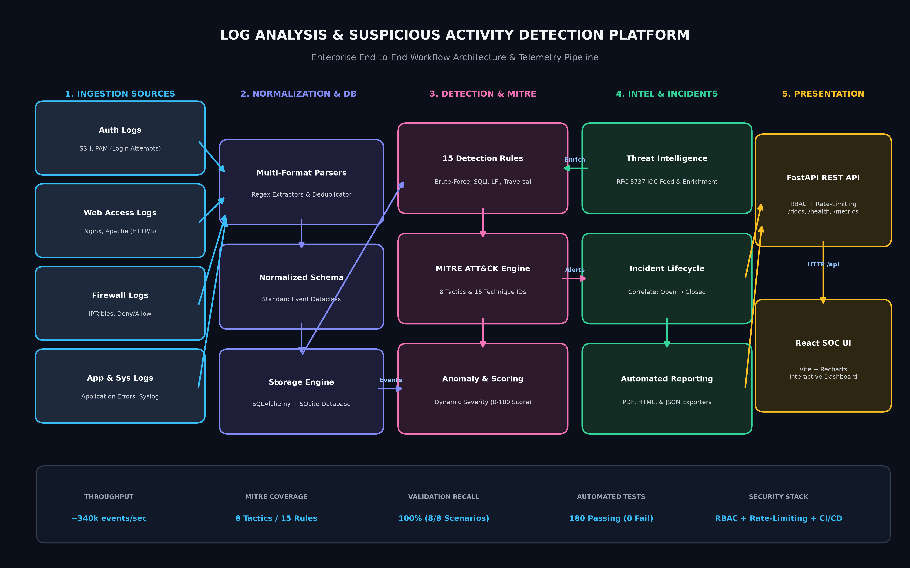

# Log Analysis & Suspicious Activity Detection

## 1. Project Description

An industry-oriented cybersecurity project designed to analyze
system, authentication, application, web, and security logs
to identify potentially suspicious activity.

The system will ingest logs, parse and normalize events,
apply security detection rules, correlate related events,
perform anomaly analysis, generate alerts, and provide
security-focused reports and visualizations.

## System Workflow Architecture



## 2. Project Objectives

- Collect and ingest security-relevant logs
- Parse multiple log formats
- Normalize log events
- Store structured security events
- Detect suspicious activity
- Correlate related events
- Perform anomaly detection
- Enrich events with threat intelligence
- Generate security alerts
- Group related alerts into incidents
- Provide investigation capabilities
- Generate security reports
- Evaluate detection effectiveness and system performance

## 3. Technology Stack

- Python
- Pandas
- NumPy
- PostgreSQL
- FastAPI
- React
- Vite
- Recharts
- Docker
- Pytest
- Git/GitHub

## 4. System Requirements

- Python 3.11+
- Git
- Visual Studio Code
- PostgreSQL
- Docker (required in later development phases)

## 5. Installation

Install the backend dependencies:

```bash
pip install -r requirements.txt
```

Install the frontend dependencies:

```bash
cd frontend
npm install
```

## 6. How to Run

Copy the environment template and set API keys before starting services:

```bash
copy .env.example .env
copy frontend\.env.example frontend\.env
```

Use the same `API_KEY` value in `.env` and `VITE_API_KEY` in `frontend/.env`.
The dashboard sends this key as `X-API-Key`. Write operations require `ADMIN_API_KEY`.

Start the backend:

```bash
uvicorn src.api.main:app --reload
```

Then start the dashboard in a second terminal:

```bash
cd frontend
npm run dev
```

Open the dashboard at:

```text
http://localhost:5173
```

## 7. Sample Input

Sample system, authentication, application, web, and security
logs will be provided under the `data/` directory.

## 8. Expected Output

The system will generate:

- Normalized security events
- Suspicious activity detections
- Security alerts
- Risk/severity information
- Correlated incidents
- Statistical summaries
- Security reports

### Dashboard

The project includes a React-based SOC dashboard that consumes the
FastAPI backend and displays:

- Total security events
- Total alerts
- High-risk alerts
- Critical alerts
- Open incidents
- Threat-intelligence records
- Alert severity distribution
- Recent alerts
- Incident queue

## 9. Log Ingestion Architecture

The project uses a modular log ingestion architecture.

The ingestion layer is responsible for discovering and reading
raw log files without performing security analysis.

Current ingestion sources:

- Authentication logs
- Web logs
- Application logs
- Security/firewall logs
- System logs

Processing flow:

Raw Logs
→ File Collector
→ Parser
→ Normalization
→ Validation
→ Deduplication
→ Storage
→ Security Analytics

The ingestion layer is designed to support additional sources
in future versions, including:

- Syslog
- Windows Event Logs
- REST APIs
- Network devices
- Cloud security logs
- SIEM data sources

## 10. Dataset Source

The project will use a combination of appropriately licensed
sample/public datasets and controlled synthetic security events.
Dataset sources and licensing information will be documented
before inclusion in the final submission.

## 11. Project Structure

```text
Log_Analysis_Suspicious_Activity_Detection/
├── README.md                          # Platform documentation and execution guide
├── requirements.txt                   # Production dependencies
├── requirements-lock.txt              # Pinned dependency manifest
├── .gitignore                         # Version control exclusions
├── .env.example                       # Configuration template
├── docker-compose.yml                 # Multi-container orchestration
├── docker/
│   ├── backend.Dockerfile             # FastAPI Python 3.12-slim container
│   ├── frontend.Dockerfile            # Multi-stage React + Alpine Nginx container
│   └── nginx.conf                     # Ingress reverse proxy & security headers
├── docs/
│   ├── deployment.md                  # Deployment guide
│   └── monitoring.md                  # Observability & telemetry architecture
├── src/
│   ├── api/                           # FastAPI gateway with RBAC & rate limiting
│   ├── dataset/                       # Dataset processing and synthetic generators
│   ├── detection/                     # 15 detection rules, correlation & MITRE mapping
│   ├── incidents/                     # Incident grouping and lifecycle management
│   ├── ingestion/                     # Multi-source log ingestion engine
│   ├── monitoring/                    # Structured logging, health probes & telemetry
│   ├── normalization/                 # Event normalization schemas
│   ├── parsers/                       # Syslog, Web, Auth, App, Firewall parsers
│   ├── performance/                   # Benchmarking and scalability suites
│   ├── reporting/                     # JSON, HTML, and PDF report synthesis
│   ├── storage/                       # SQLite / PostgreSQL persistence models
│   ├── threat_intel/                  # IOC lookup & feed enrichment
│   └── validation/                    # Controlled adversary threat scenarios
├── frontend/                          # Vite + React SOC dashboard
├── data/                              # Labelled datasets and analytics database
├── models/                            # Machine learning model assets
├── tests/                             # 127 automated unit, integration, and security tests
├── reports/
│   ├── generated/                     # Security reports (HTML, PDF, JSON)
│   ├── mitre/                         # ATT&CK matrix coverage report
│   ├── monitoring/                    # Observability verification report
│   ├── performance/                   # Performance & benchmark reports
│   ├── security/                      # Dependency and security audit reports
│   └── validation/                    # Empirical scenario validation reports
└── screenshots/                       # Visual evidence for submission
```

## 12. Running the Complete Application

### Terminal 1 — Backend API
```bash
uvicorn src.api.main:app --host 127.0.0.1 --port 8000
```
- Interactive API Documentation: [http://127.0.0.1:8000/docs](http://127.0.0.1:8000/docs)
- Detailed Health Probes: [http://127.0.0.1:8000/health/detailed](http://127.0.0.1:8000/health/detailed)
- Telemetry Metrics: [http://127.0.0.1:8000/metrics](http://127.0.0.1:8000/metrics)

### Terminal 2 — Frontend Dashboard
```bash
cd frontend
npm run dev
```
- SOC Web Dashboard: [http://localhost:5173](http://localhost:5173)

### Terminal 3 — Execute End-to-End Pipeline
```bash
python -m src.parsers.run_parsers
python -m src.storage.import_events
python -m src.detection.run_detection
python -m src.threat_intel.import_feed
python -m src.incidents.create_incidents
python -m src.reporting.generate_report
```

## 13. Running Automated Tests
Run the entire regression test suite (127 automated tests across all 7 test suites):
```bash
python -m pytest tests/detection tests/validation tests/performance tests/security tests/deployment tests/monitoring tests/mitre -v
```

## Project Status

**Phase 22 — Final Integration & Submission Preparation (Ready for Demonstration)**

## Academic Use

This project is developed for educational and cybersecurity research purposes and should only be deployed against systems and data for which appropriate authorization exists.

