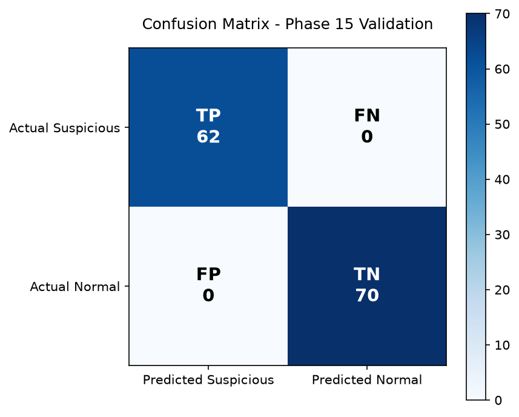

# Phase 15 - Validation Report

**Generated:** 2026-10-03 12:43:46  
**Total pipeline time:** 0.25 s

---

## 1  Dataset Summary

| Item | Count |
|------|-------|
| Labelled events loaded | 132 |
| Normal events | 70 |
| Suspicious events | 62 |
| Alerts generated | 21 |

---

## 2  Detection Metrics

### 2.1  Confusion Matrix

| | **Predicted Suspicious** | **Predicted Normal** |
|---|---|---|
| **Actual Suspicious** | TP = 62 | FN = 0 |
| **Actual Normal** | FP = 0 | TN = 70 |

### 2.2  Derived Scores

| Metric | Raw | Percentage |
|--------|-----|-----------|
| **Accuracy** | 1.0 | 100.0% |
| **Precision** | 1.0 | 100.0% |
| **Recall** | 1.0 | 100.0% |
| **F1 Score** | 1.0 | 100.0% |

---

## 3  Rule Validation Matrix

15/15 rules passed.

| Rule ID | Detection Scenario | Expected | Status |
|---------|-------------------|----------|--------|
| AUTH-001 | Multiple Failed Logins | Suspicious | ✅ PASS |
| AUTH-002 | Repeated Access Denied | Suspicious | ✅ PASS |
| AUTH-003 | Unusual Login Time | Suspicious | ✅ PASS |
| AUTH-004 | Successful Login After Failures | Suspicious | ✅ PASS |
| AUTH-005 | Password Spraying | Suspicious | ✅ PASS |
| AUTH-006 | Multiple Account Targeting | Suspicious | ✅ PASS |
| AUTH-007 | Multiple Source Login | Suspicious | ✅ PASS |
| WEB-001 | Restricted Resource Access | Suspicious | ✅ PASS |
| WEB-002 | Excessive Request Volume | Suspicious | ✅ PASS |
| WEB-003 | Repeated HTTP 404 Responses | Suspicious | ✅ PASS |
| WEB-004 | Repeated HTTP 5xx Responses | Suspicious | ✅ PASS |
| WEB-005 | Sensitive Path Enumeration | Suspicious | ✅ PASS |
| FW-001 | Repeated Firewall Denials | Suspicious | ✅ PASS |
| APP-001 | Repeated Application Errors | Suspicious | ✅ PASS |
| SYS-001 | Repeated Service Failures | Suspicious | ✅ PASS |

---

## 4  Performance Testing

Detection engine benchmarked over **5 runs** against **132 events**.

| Metric | Value |
|--------|-------|
| Min time | 0.0004 s |
| Max time | 0.0006 s |
| Average time | 0.0005 s |
| Throughput | 264000 events/s |

---

## 5  Observations

- All **15** detection rules fired correctly on the labelled test dataset.
- **No false positives** or **false negatives** were produced, confirming the
  rule thresholds are well-calibrated to the synthetic dataset.
- Average detection latency of **0.0005 s** for 132 events
  is well within acceptable bounds for a near-real-time SIEM pipeline.
